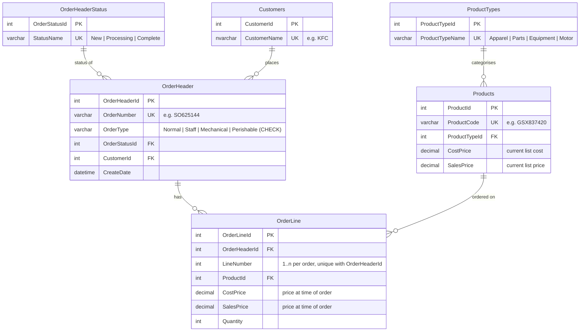

# ER Diagram - Sales Orders

The completed version of the supplied `ER Diagram.docx` template. It uses the same six tables
and relationships drawn in the template, with columns taken from the XML structure and from the
dropdown lists in the spec.

## Tables

| Table | Column | Key | Source |
|---|---|---|---|
| **OrderHeader** | OrderHeaderId | PK | surrogate |
| | OrderNumber | Unique | XML `OrderNumber` |
| | OrderType | | Dropdown: Normal, Staff, Mechanical, Perishable |
| | OrderStatusId | FK to OrderHeaderStatus | XML `OrderStatus` |
| | CustomerId | FK to Customers | XML `CustomerName` |
| | CreateDate | | XML `CreateDate` |
| **OrderLine** | OrderLineId | PK | surrogate |
| | OrderHeaderId | FK to OrderHeader | parent `SalesOrder` |
| | LineNumber | Unique per order | XML `LineNumber` |
| | ProductId | FK to Products | XML `ProductCode` |
| | CostPrice | | XML `CostPrice` |
| | SalesPrice | | XML `SalesPrice` |
| | Quantity | | XML `Quantity` |
| **Products** | ProductId | PK | surrogate |
| | ProductCode | Unique | XML `ProductCode` |
| | ProductTypeId | FK to ProductTypes | XML `ProductType` |
| | CostPrice | | current list cost |
| | SalesPrice | | current list price |
| **ProductTypes** | ProductTypeId | PK | surrogate |
| | ProductTypeName | Unique | Dropdown: Apparel, Parts, Equipment, Motor |
| **OrderHeaderStatus** | OrderStatusId | PK | surrogate |
| | StatusName | Unique | Dropdown: New, Processing, Complete |
| **Customers** | CustomerId | PK | surrogate |
| | CustomerName | Unique | XML `CustomerName` |

## Design notes

- **Order Type** has no lookup table in the template, so it is a column on `OrderHeader`
  restricted by a `CHECK` constraint.
- **Prices appear on both `Products` and `OrderLine`.** `Products` holds the current list price,
  and `OrderLine` holds the price that was charged. Changing a product's price later does not
  change historical orders.
- Deleting an `OrderHeader` cascades to its `OrderLine` rows.

The runnable script is [`database/CreateDatabase.sql`](../database/CreateDatabase.sql).
